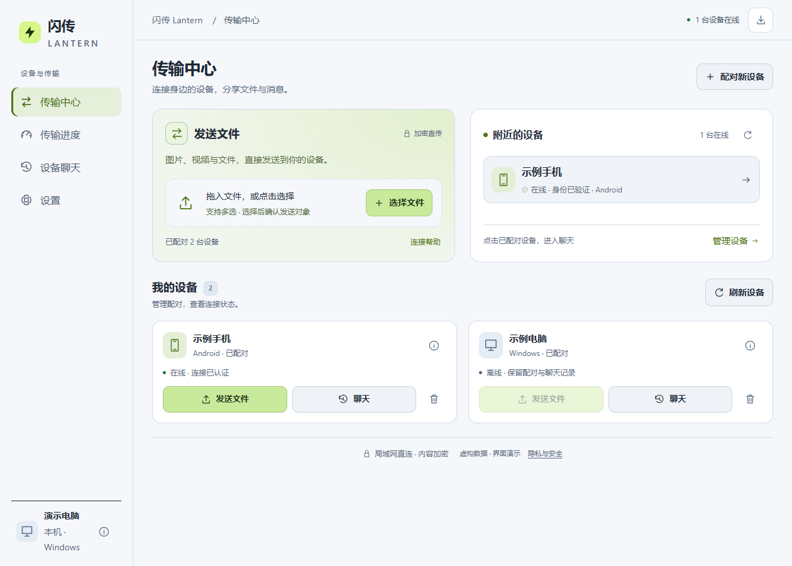
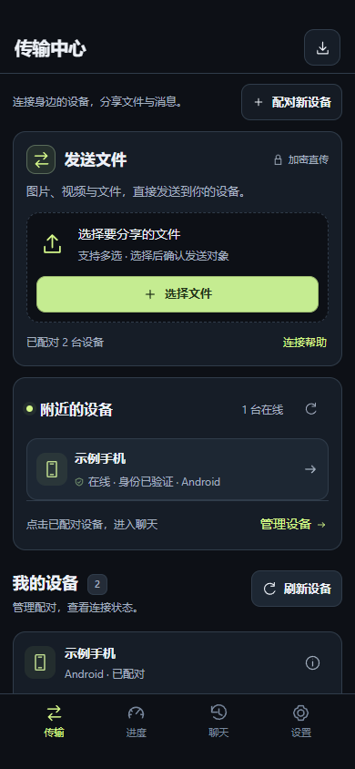
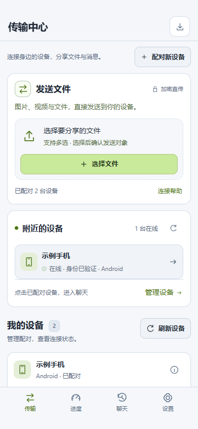
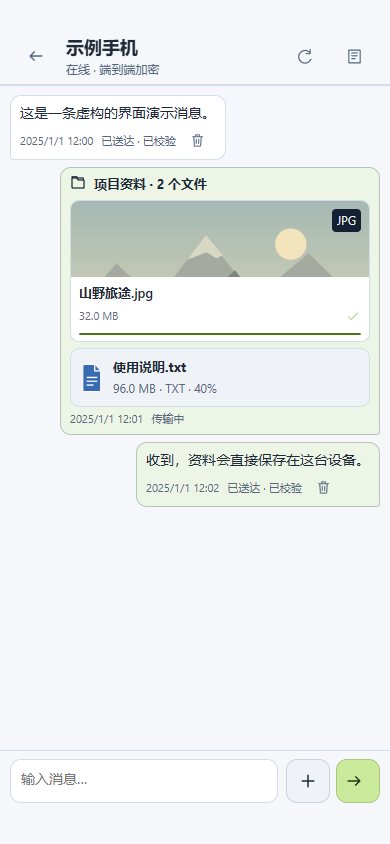
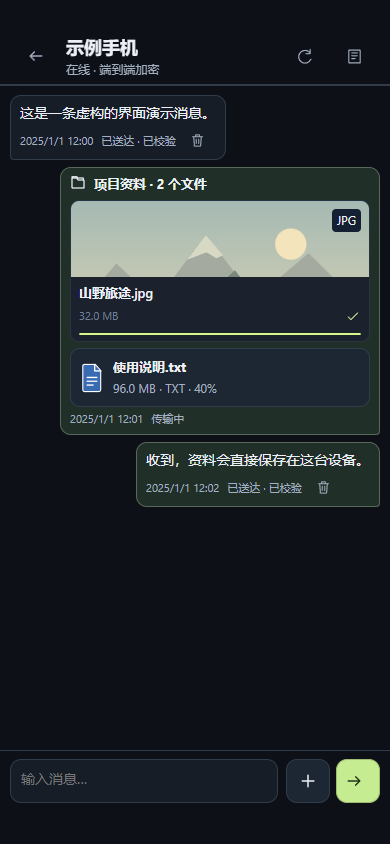
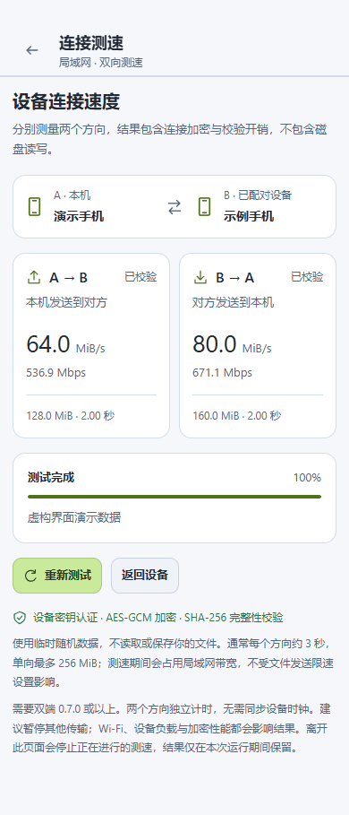
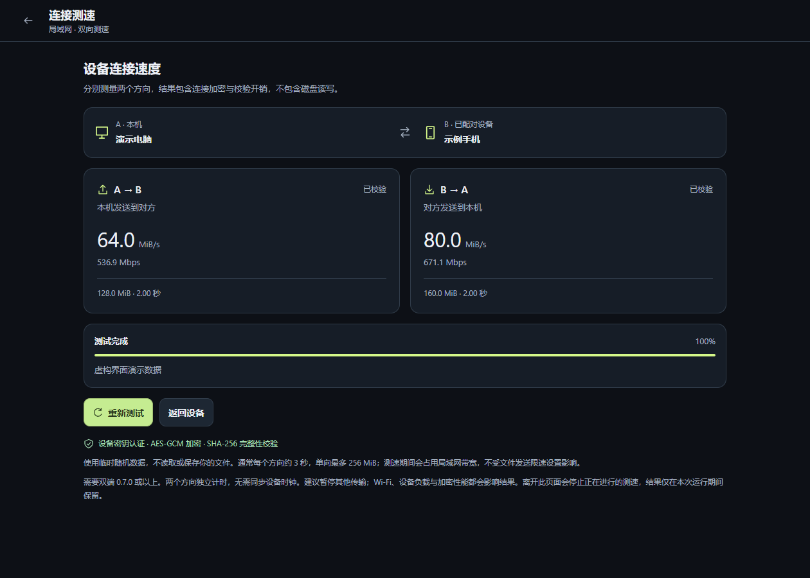

# 闪传 Lantern

让分享回归设备之间。快速直连，尊重每一份隐私。

局域网文件传输及设备聊天工具，提供 Windows 与 Android 客户端，以及 iPhone 与 iPad 通用项目。当前源码版本 **0.7.13**，Android versionCode **46**。本仓库准备包仅含源码、项目资源与开发文档，不含已签名客户端、个人设备数据或原始开发历史。

## 功能

- 匹配码与双方确认建立配对；记住设备密钥，每次连接重新认证。
- 文字、图片与文件通过认证后的加密通道传输，并校验完整性及回执。
- 多设备发现、独立任务、群发、进度/速度统计与设备聊天记录。
- Windows 支持拖拽、文件右键操作、通知、任务栏进度及接收目录选择。
- Android 在本机解密和校验后保存到公开目录；支持通知与系统栏适配。
- Android 和 Windows 直接连接发布服务器检查并下载更新，支持自动选源和分别检查稳定版、测试版。
- 已配对设备之间可进行独立双向连接测速；测试数据加密、校验且不落盘。
- 安卓 APK 与 Windows ZIP 分别发布。安卓通过系统安装界面升级，Windows 由用户手动升级。
- 共享深浅主题、字号与界面缩放、快捷设备入口、短页面过渡。
- iPhone 和 iPad 目标共享协议与界面资源，使用 UIKit 导航、系统文件选择器、Quick Look 与本机钥匙串。
- 0.7.5 起四类设备使用同一 Bonjour 服务发现对方，配对需要匹配码和双方确认。发现受网络或系统授权限制时，可输入局域网 IP 连接。

## 界面演示

下图使用虚构设备、文档示例地址与演示内容，不包含真实设备或聊天记录；属于浏览器界面演示，不作为 Android 真机兼容证明。



 

## 目录

| 目录 | 内容 |
| --- | --- |
| src/Lantern.Core | 配对、身份认证、AES-GCM、发现和流式文件传输 |
| src/Lantern.AppLogic | 共享业务、聊天记录、设置、任务与 OTA |
| src/Lantern.Windows | WinForms、WebView2、DPAPI、通知和文件管理 |
| src/Lantern.Android | Android 原生入口、WebView、Keystore 与公开存储 |
| src/Lantern.iOS | iPhone 与 iPad 通用项目，UIKit、WebKit、Bonjour 和钥匙串 |
| ui | 共享页面、离线交互演示与项目内编写的 SVG |
| tests | 协议、业务、存储与原生启动回归检查 |
| tools | 无个人路径的检查、构建及更新工具 |
| licenses | 原样保留的第三方许可与声明 |

## 开始开发

使用 .NET 10 SDK；Windows 目标 .NET 8 Windows Desktop。Android 目标 API 36、最低 API 26，提供 ARM64 和 x86_64 架构；Android 构建另需 Android workload、SDK 和 JDK 21。

```powershell
dotnet build src/Lantern.Windows/Lantern.Windows.csproj -c Release
pwsh -File tools/Run-Checks.ps1
pwsh -File tools/Check-PublicSource.ps1 -StrictExport
```

完整步骤见 [构建与签名](docs/BUILD.md)、[测试](docs/TESTING.md)、[OTA 打包](docs/RELEASING.md)。在 Mac 上构建 iPhone/iPad 目标与真机验证的说明见 [Apple 项目文档](src/Lantern.iOS/README.md)。请使用虚构的测试资料。

ui/index.html 是离线演示，示例设备、地址、指纹和文件均为虚构；预览模式不会发送文件。原生客户端从系统读取本机信息，并在运行时生成、保管自己的密钥。

## 安全与隐私

网络加密不隐藏设备昵称、IP、包长或时序；也不保护已经被控制的终端和已授权端点。保存到公开文件夹的文件遵循操作系统本地访问权限。实现尚未经过独立密码协议审计，Android 17 / API 37 与厂商系统仍需真机验证。

详见 [安全设计及漏洞报告](SECURITY.md)、[隐私说明](PRIVACY.md) 和 [公开前检查](docs/PUBLISHING.md)。开源会公开实现，不需要包含任何真实设备密钥、历史记录、签名材料或用户资料。

## 许可与贡献

项目原创部分准备采用 [MIT](LICENSE)，署名为项目贡献者集合；公开发布前由维护者确认许可选择。第三方组件继续适用各自许可证，见 [第三方声明](THIRD_PARTY_NOTICES.md)。

欢迎阅读 [贡献指南](CONTRIBUTING.md) 后提交问题和改进。测试安装包与更新日志见 [GitHub 发行页](https://github.com/altale0218/lantern-releases/releases) 和 [Gitee 发行页](https://gitee.com/altalatic/lantern-releases/releases)。

更新中心用 HTTPS 访问公开发行页对应的服务器，不依赖局域网配对。Android 安装前同时校验 SHA-256、包名、版本和原应用签名。Windows 下载并校验 ZIP 后由用户手动更新。

## 安卓紧凑聊天预览

以下界面使用虚构设备、消息与附件生成，不包含个人资料。输入栏合并为一行，正文和字号缩放保持可读。

| 浅色聊天 | 深色聊天 |
| --- | --- |
|  |  |

## 设备连接测速预览

进入“我的设备”中已配对在线设备下的“连接测速”，自动分别测试 A → B 和 B → A。双端需要 0.7.0 或以上。下图数值为明确虚构的界面演示，不是实际带宽测量结果。

 


